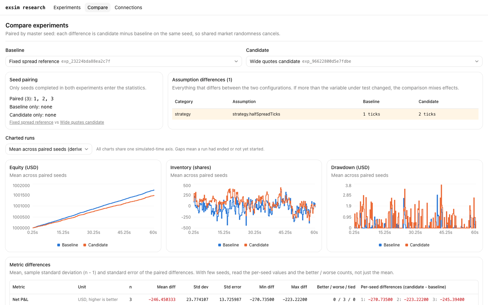

# exsim

A C++20 exchange simulator with a browser workbench for strategy research. Configure an experiment, run it on simulated time, compare common seeds, and trace a fill back to its orders, queue position and ledger changes.

The first workflow is execution and market-making research. The browser demo uses fixed-spread quoting against seeded market makers and noise takers. All matching, simulated time, strategies, accounting and protocol behavior run in C++.

[](docs/demo/exsim-product-walkthrough.mp4)

**[Watch the product walkthrough](docs/demo/exsim-product-walkthrough.mp4)** · [Screens and recording notes](docs/demo/README.md) · [Production setup](docs/DEPLOYMENT.md)

The recording shows the production Next.js frontend using real C++ runs, including experiment creation, pause/step/resume, accounting, fill inspection and a three-seed comparison. The data is synthetic; the results are not evidence of profitability in a live market.

## Research workflow

1. **Configure.** Start from a narrow or wide quoting baseline, or copy a saved experiment as a variant. Choose fixed-spread or inventory-aware quoting. Set market-agent parameters, common seeds, feed/order/acknowledgment/cancel delays, fees, risk limits and a simulation bound. Review the assumptions before starting.
2. **Run.** Let simulated time advance to completion, or start paused and step scheduler events. Each run owns its engine, RNG streams and accounting state. A partially started batch stays saved; its experiment page starts only missing seeds.
3. **Compare.** See changed assumptions, aligned equity/inventory/drawdown charts, per-seed differences, sample standard deviation and standard error. Only completed runs whose native evidence reproduces under the expected configuration and seed enter the paired result. Comparison values come from that fresh execution.
4. **Explain.** Inspect the event timeline, exchange truth versus the delivered strategy view, FIFO quantity ahead, order lifecycles, fill roles, fees and markouts. A completed run can retain inventory and resting orders; the summary reports both.

## What is implemented

| Surface | Capabilities |
| --- | --- |
| Browser workbench | Experiment templates, seed runs, pause/step/resume/cancel, assumptions and manifests, accounting and risk summaries, paired comparisons, event/book/order/fill inspection |
| C++ research runner | Fixed-spread and inventory-aware market makers, TWAP and immediate-sweep execution baselines, latency models, FIFO accounting, bounded recording, manifests, seed sweeps and independent replay |
| Real-time exchange | OUCH 4.2/SoupBinTCP, FIX 4.4, and SBE over FIXP order entry; ITCH 5.0/MoldUDP64 publishing and retransmission; simulated liquidity, admin controls, faults, session recovery and cancel-on-disconnect |
| Matching engine | Price-time priority, continuous trading and auctions, market/IOC/FOK and post-only orders, STP, replace/partial cancel, mass cancel and expiry |
| Validation | Reference oracle, differential fuzzing and shrinking, scenarios, canonical journals and replay, decoder corpora, allocation guards, sanitizer and cross-platform checks |

The browser templates currently expose fixed-spread variants. The HTTP service also executes inventory-aware configurations; parent-order execution remains a CLI workflow. Historical replay models, arbitrary uploaded strategy code, multi-user authentication and live-server monitoring through the research UI are not implemented. Synthetic agent models are controlled experiments, not calibrated market impact.

## Start locally

Requires a C++20 compiler, GNU Make, Bun, and Node.js for Next.js. Tested compilers include Apple clang, GCC 14 and Clang 19.

```sh
cd web
bun install --frozen-lockfile
bun run dev
```

This builds and starts `exsim_api` on loopback port 7600 with Next.js on port 3000. Open `http://localhost:3000`. The explicit `bun run dev:mock` command selects the TypeScript mock for UI-only work.

For a production build, standalone deployment, persistent macOS services and a private Tailscale link, see [DEPLOYMENT.md](docs/DEPLOYMENT.md).

## Automate research

```sh
make -j4 tools EXTRA_CXXFLAGS=-Werror

./build/release/exsim_research run config/research/fixed_spread_narrow.conf \
  --out /tmp/exsim-narrow --seeds 1..5
./build/release/exsim_research run config/research/fixed_spread_wide.conf \
  --out /tmp/exsim-wide --seeds 1..5
./build/release/exsim_research compare /tmp/exsim-narrow /tmp/exsim-wide
```

The CLI re-executes runs before comparison by default. Native artifacts include the saved configuration, manifests, commands/events, lifecycle evidence, series, ledger records, summary and replay verification. See [RESEARCH_RUNNER.md](docs/RESEARCH_RUNNER.md).

## Connect over exchange protocols

```sh
./build/release/exsim_server --config config/exsim.conf
./build/release/exsim_client --user ALICE --password alice --server 127.0.0.1:15000 \
  "buy A1 SPY 100 400.00" "wait 1500" "cancel A1"
```

The protocol runtime is a separate process from deterministic browser research. It uses a single reactor for order state, preallocated hot-path storage, and a bounded journal handoff to a persistence worker. Queue overflow and persistence failure follow explicit shutdown/continue policies. A stalled journal cannot silently become a successful complete capture. [Runtime and protocol documentation](docs/SERVER_RUNTIME.md).

## Architecture and stack

- **C++:** matching, simulation, strategies, accounting, network protocols, journals and the HTTP service.
- **Frontend:** Bun, Next.js, TypeScript, Tailwind CSS and shadcn/ui, with self-hosted IBM Plex typography. The research workstation has persistent navigation, a searchable experiment library, compact run outcomes and a keyboard-driven event tape. The browser uses a same-origin proxy and generated OpenAPI types. [Design notes](docs/UI_DESIGN.md).
- **Shared implementation:** deterministic research and the real-time protocol runtime instantiate the same matching-engine code, with separate state. The engine itself reads no clock, performs no I/O and uses no randomness.

[Product decisions](docs/PRODUCT.md) · [Architecture](docs/ARCHITECTURE.md) · [Matching specification](docs/SPEC.md) · [HTTP/OpenAPI](docs/API.md) · [Gateway contracts](docs/GATEWAYS.md)

## Validation

```sh
make -j4 test EXTRA_CXXFLAGS=-Werror
make -j4 test MODE=debug EXTRA_CXXFLAGS=-Werror
make -j4 test MODE=tsan FILTER=server_ EXTRA_CXXFLAGS=-Werror

cd web
bun test
bun run typecheck
bun run lint
bun run build
bun run test:e2e
```

Latest integration repair checks: **932** macOS release tests, **928** ASan/UBSan tests, **143** focused server TSan tests, and **9** real-binary HTTP contract tests covering all 23 operations. Linux GCC and Clang each passed **53** focused API/runtime checks and built both service binaries after the repairs. The earlier combined Linux snapshot passed 927 tests with each compiler. Frontend invariants: **73**, plus typecheck, lint, production build and **6** isolated browser recovery checks. Deployment tooling: **40** disposable fixture checks. These new checks do not replace the historical C++ integration evidence.

Five new regressions fail the reviewed pre-fix code and pass the repairs. Exact revisions, logs and limits: [integration fixes](docs/reviews/INTEGRATION_FIXES_2026-11-06.md), [working checkpoint](docs/WORK_PLAN.md), [fuzzing](docs/FUZZING.md).

## Performance and project history

Measured engine and protocol results, their hardware/setup and limits are in [PERFORMANCE.md](docs/PERFORMANCE.md). The walkthrough is a product demonstration, not a benchmark. Unselected FIX codec optimization branches remain outside this integration.

exsim grew out of `lob`, a limit order book project. Its earlier implementation and benchmarks remain documented in [LOB_HISTORY.md](docs/LOB_HISTORY.md).
