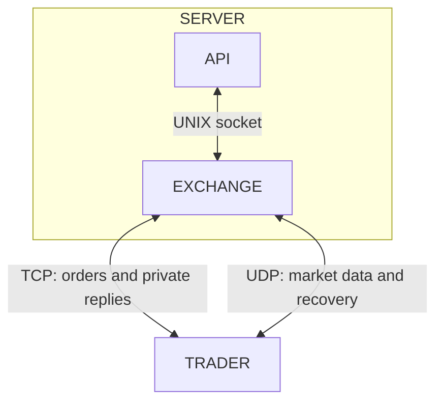

# Exsim

A simple exchange simulator for testing trading strategies with various trading protocal supported.



## Getting Started

From the repository root:

```sh
make -j4 apps
./build/release/exsim_api --bind 127.0.0.1 --port 7600 --data-dir exchanges
```

This builds both binaries and starts the management API at `http://127.0.0.1:7600`. Create and start exchanges through the API using the [API specs](./docs/api.md).

To run a standalone exchange directly instead:

```sh
./build/release/exsim_exchanged --config test/fixtures/exchange.conf
```

It starts with empty books, waiting for external trading clients. Stop either process with **Ctrl+C**.

To run tests or benchmarks:

```sh
make -j4 test
make -j4 bench
```

## Limitations

- This is a very early alpha, expects bugs.
- We provided only exchange simulator, you have to have your own trader engine.
- Currently only support ITCH 5.0, OUCH 4.2, and FIX 4.4.

## Further Reading

- [API specs](./docs/api.md)
- [Architecture](./docs/architecture.md)
- [Choices of Data structures and Rationale](./docs/dsa.md)
- [TEST](.test/README.md)
- [BENCHMARK](.benchmark/README.md)
