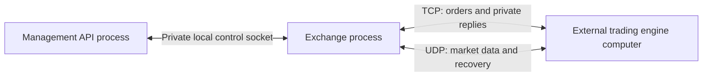

# Exchange architecture

Exsim hosts empty exchanges. External trading engines provide every order and all liquidity. One C++ HTTP API manages definitions and supervises one C++ process per running exchange. Live exchange state stays in RAM; definitions are small INI files.

## Processes

Each node is one process, except the external trading engine node, which is one computer. Repeat exchange and trader nodes as needed.

Matching, gateways, market-data publication, and recovery all run inside the exchange process. The API is outside the trading path. No frontend, trader worker, strategy templates, bots, research orchestration, or PostgreSQL is required.

## Endpoints

For two exchanges on the same host, use seven configured ports:

| Purpose | Exchange A | Exchange B |
| --- | --- | --- |
| Shared management HTTP/TCP | 7600 | 7600 |
| Order entry and private responses, TCP | 15000 | 15010 |
| Public feed destination, UDP multicast | 16000 | 16010 |
| Recovery requests and replies, UDP unicast | 16001 | 16011 |

This is five listening endpoints on the host and two public feed destinations. Use different multicast groups for the two feeds. The private control sockets need no TCP/UDP ports. Trader computers connect to these existing endpoints; more traders do not add exchange listeners. Their temporary source ports are assigned by their operating systems.

The first enabled profile is OUCH 4.2 over SoupBinTCP 3.0 for order entry, with ITCH 5.0 over MoldUDP64 for public events. The FIX and FIXP/SBE codec and gateway libraries remain tested, but their network listeners are not exposed by this daemon yet. Transport comes from the protocol profile, not an independent TCP/UDP toggle.

Many traders share one TCP listener with separate connections and authenticated sessions. Public market data uses multicast group membership; recovery is a separate unicast request/reply service. TCP and UDP may share a numeric port, but distinct numbers make configuration clearer.

## Management

See [API usage](api.md) and [OpenAPI](openapi.json). The API provides definition CRUD, start/stop, status, and actual connection details. A definition is created stopped. Each start creates a fresh session identity and empty books.

Start waits for socket readiness before returning `200`. Stop waits for bounded graceful shutdown, then forces termination if necessary. Repeated start or stop returns the existing state without duplicating work. Running definitions cannot be edited or deleted (`409`). After startup failure or a crash, an exited definition can be corrected, deleted, or restarted.

The API serializes management operations and reports process exits when servicing requests. OS socket binding is the final authority for port conflicts; partial startup failure closes every socket and reaps the child. Running exchanges cannot share the same feed destination. The config directory is locked to one API process.

All private IPC messages have bounded sizes and timeouts. Status requests run between exchange loop iterations. This is a simple operator path, not a high-frequency telemetry service. A control failure stops the affected child and reports failure rather than returning stale live state as healthy.

On API shutdown, children drain concurrently and are reaped. On manager crash, closing the private socket causes children to shut down. Definitions reload as stopped after API restart. There is no automatic process restart or live-state recovery.

## Exchange behavior

A gateway validates framing and session state, then translates messages into exchange commands. One loop sequences commands across sessions. The core validates instrument rules and applies matching, then routes private session responses and public events.

Keep the matching engine independent of sockets and wall-clock reads. The runtime supplies monotonic elapsed timing and trading-day timestamps. External traffic is real-time input, so a seed alone cannot reproduce it.

Order pools, session buffers, and recovery history are bounded and allocated at startup. The existing core and gateway allocation checks remain active. Capacity failures reject orders; slow TCP consumers follow gateway disconnect rules instead of growing unbounded queues.

An empty exchange still needs instruments, tick/lot sizes, limits, users, session rules, and initial trading phases. The sample config starts AAPL in continuous trading so external clients can trade immediately. Protocol support is a defined subset, not a claim of complete venue compatibility.

## Files and network scope

The manager saves full config files with owner-only permissions and atomic replacement. API responses redact passwords. Replacing a definition requires a full config with credentials. Managed journals are not enabled in the first API; standalone exchanges retain the existing optional journal settings.

Books, orders, session sequences, and retransmission buffers are discarded when the exchange exits. Journal files support offline inspection, not automatic crash recovery. Abrupt termination may lose buffered journal records.

MoldUDP64 recovery covers retained session history only. Join before trading begins. Late join or a gap beyond the ring needs a fresh session or a future snapshot service. A retransmission ring is not a full book snapshot service.

Run native processes on macOS or Linux. Docker and Compose were removed. Use a specific local IPv4 bind address and the correct interface for multicast. A unicast feed destination supports one receiver, not multicast fan-out. Remote clients need a reachable host address and a multicast-capable LAN. Public internet routing and HTTP proxies do not provide multicast delivery.

## Verification and remaining work

Active verification is unit and integration testing, locally on macOS and OrbStack Ubuntu. See [test commands](../test/README.md). Retain core/session correctness and allocation coverage, protocol golden vectors, network integration, API CRUD/lifecycle, and external TCP/UDP interaction checks.

Fuzz campaigns, benchmarks, and old end-to-end suites are deferred. Further protocol profiles, live snapshots, managed journals, remote authentication, and larger-scale telemetry need separate implementation and validation. Removed reports or obsolete tests do not resolve outstanding correctness findings.

## References

- [SoupBinTCP 3.0](https://www.nasdaqtrader.com/content/technicalsupport/specifications/dataproducts/soupbintcp.pdf)
- [MoldUDP64](https://www.nasdaqtrader.com/content/technicalsupport/specifications/dataproducts/moldudp64.pdf)
- [RFC 6335: transport port identifiers](https://www.rfc-editor.org/rfc/rfc6335.html)
