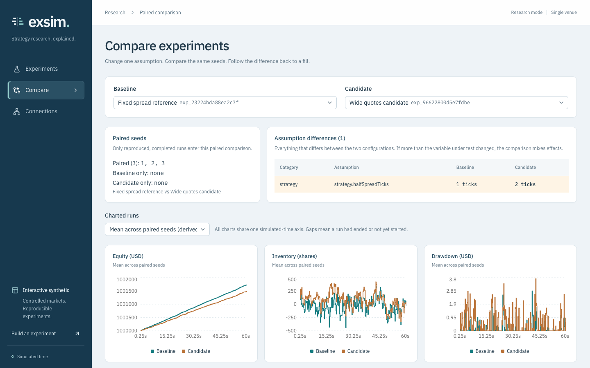
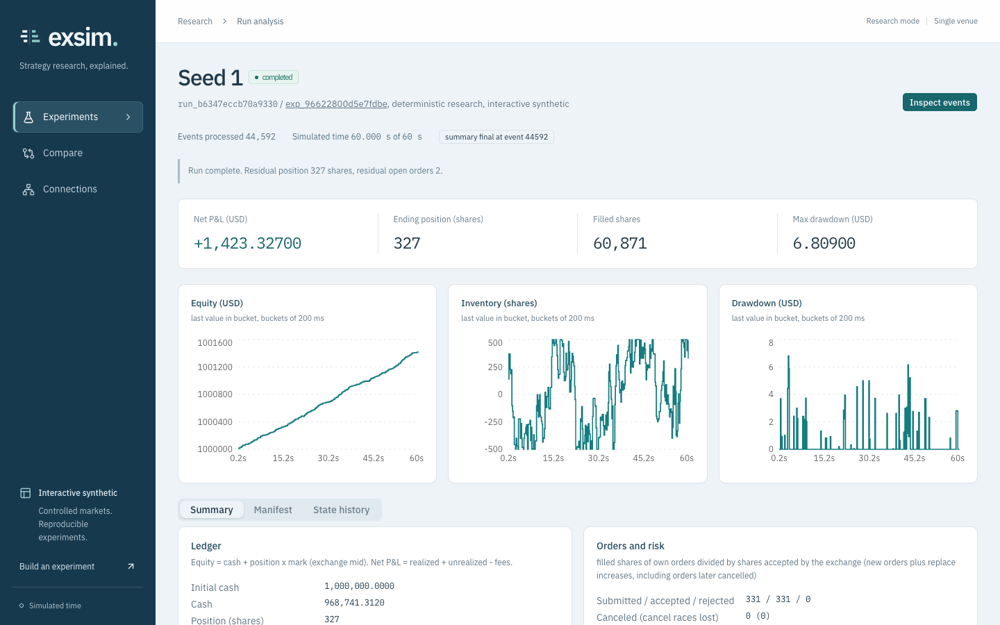
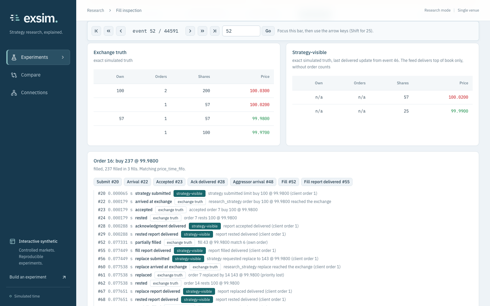
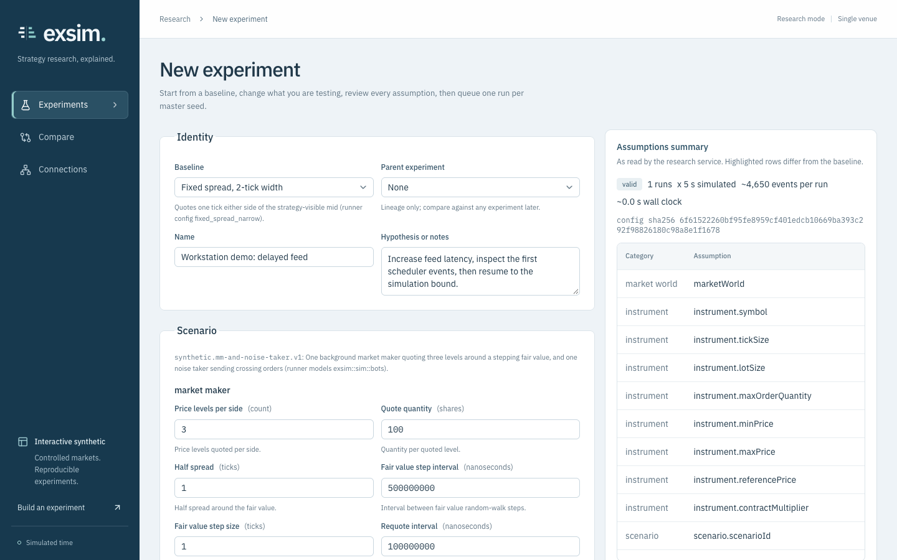
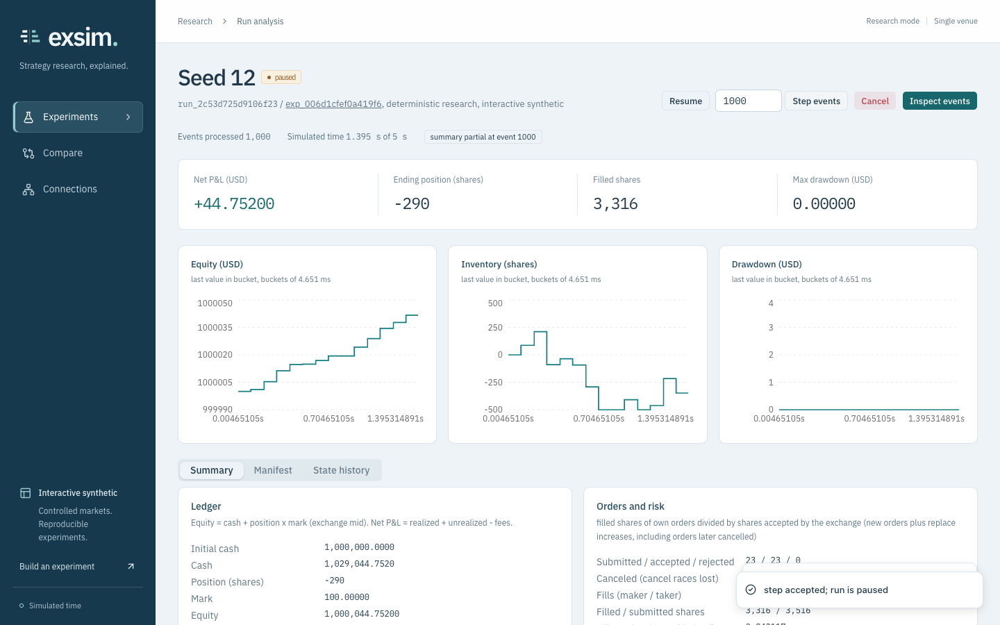

# Research product walkthrough

[Watch the MP4](exsim-product-walkthrough.mp4) · [Chapter captions](walkthrough.vtt)

The silent walkthrough records the production Next.js frontend connected through Tailscale Serve to the real C++ research service. Every experiment, chart, event and fill shown comes from an executed synthetic simulation. It does not use the mock service or fabricated chart data.

| Approximate time | Scene |
| --- | --- |
| 00:00 | Experiments and completed seed runs |
| 00:05 | Configure a quoting experiment, feed delay and assumptions |
| 00:12 | Start paused, step 1,000 scheduler events, resume to completion |
| 00:19 | Equity, inventory, drawdown and fixed-point accounting |
| 00:24 | Event stepping, a fill's order lifecycle and exchange/strategy views |
| 00:34 | Compare three common seeds and expose the changed quote width |
| 00:41 | Paired metric differences, dispersion and per-seed drill-down |
| 00:47 | Inspect the manifest and return to the summary |

The comparison changes only `strategy.halfSpreadTicks`, from 1 to 2, across seeds 1, 2 and 3. In this particular synthetic experiment the wider quotes have lower net P&L on all three seeds. Three seeds and an uncalibrated synthetic market do not establish a live trading result.

## Screens

## Capture and checks

Refreshed after the frontend redesign on 2026-11-06 at 1440 x 900. The recording includes the searchable experiment library and the new research workstation layout. The UI was driven in an isolated Chromium session after the preview bridge and desktop browser surfaces were unavailable. Navigation, form entry, run controls, event stepping and fill selection used actual rendered controls. The final pass completed all eight scenes, with 57 API responses, zero failed API responses and zero browser exceptions. The MP4 was decoded end to end after encoding.

The visual direction follows the installed Anthropic frontend-design skill; [design notes](../UI_DESIGN.md) describe the choices. The Next.js production build enables standalone output. The C++ research source is the validated integration at `edc13b0`; this publishing change does not alter simulation or matching behavior. Host-specific Tailscale addresses, property lists, logs and run artifacts are not included in these assets. Reproduction and service management: [DEPLOYMENT.md](../DEPLOYMENT.md).
